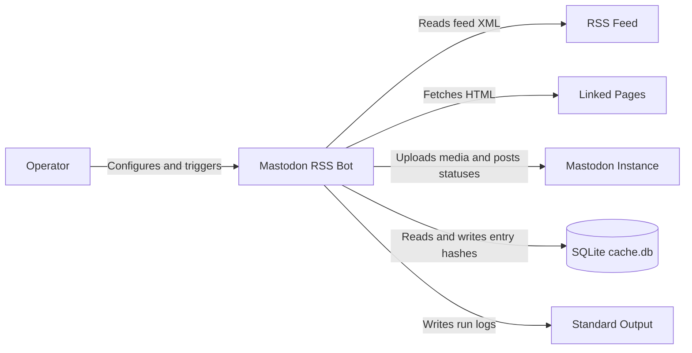
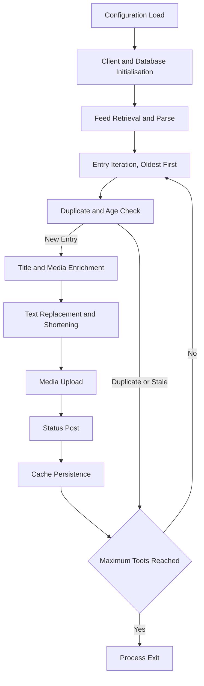
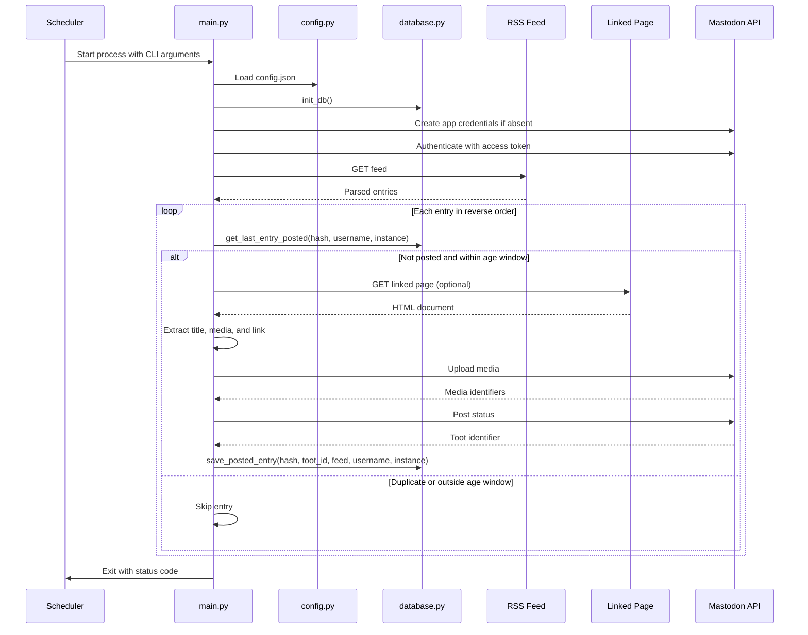
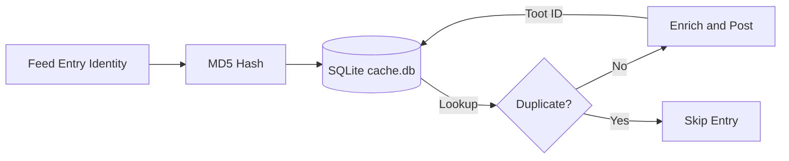
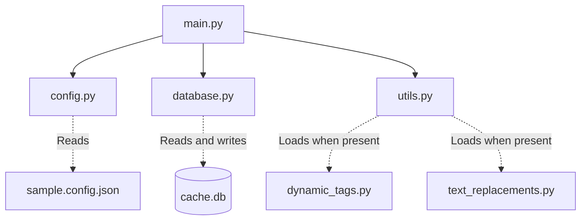

# Mastodon RSS Bot Architecture

This document covers the current architecture of Mastodon RSS Bot, a self-hosted Python command-line application that fetches RSS feed entries and posts them to a Mastodon account. It describes the verified implementation in the repository, not a proposed design.

## 📑 Table of Contents

- [Purpose](#-purpose)
- [System Context](#-system-context)
- [Architectural Style](#-architectural-style)
- [Runtime Process](#-runtime-process)
- [Components](#-components)
- [Data Architecture](#-data-architecture)
- [Interfaces and Integrations](#-interfaces-and-integrations)
- [Toot Construction](#-toot-construction)
- [Cross-Cutting Concerns](#-cross-cutting-concerns)
  - [Security and Privacy](#-security-and-privacy)
  - [Error Handling](#-error-handling)
  - [Observability](#-observability)
  - [Configuration](#-configuration)
  - [Concurrency and Resource Use](#-concurrency-and-resource-use)
- [Dependency Direction and Rules](#-dependency-direction-and-rules)
- [External Dependencies](#-external-dependencies)
- [Deployment and Operations](#-deployment-and-operations)
- [Compatibility Contracts](#-compatibility-contracts)
- [Testing and Verification](#-testing-and-verification)
- [Design Constraints](#-design-constraints)
- [Extension Points](#-extension-points)
  - [Dynamic Tags](#-dynamic-tags)
  - [Text Replacements](#-text-replacements)
  - [Additional Privacy Frontends](#-additional-privacy-frontends)
  - [Additional Media Sources](#-additional-media-sources)
- [Related Documentation](#-related-documentation)

## 🎯 Purpose

Mastodon RSS Bot syndicates RSS feed entries to a Mastodon account. Its principal responsibility is to fetch a configured feed, identify new entries within a configurable age window, enrich each entry with linked-page metadata and media, apply language-aware text transformations, and post the result through the Mastodon API while preventing duplicates. The intended audience is the contributing developer and the self-hosting operator. Recording these boundaries clarifies ownership, data flow, and change-sensitive contracts.

## 🌐 System Context

The system boundary is the single Python process started by the operator or scheduler. The principal external boundaries are:
- **RSS Feed:** Outbound HTTP GET; returns feed XML parsed by feedparser; the operator owns the feed URL supplied via command line.
- **Linked Pages:** Outbound HTTP GET with a rotating User-Agent; returns HTML parsed with BeautifulSoup; used only for optional enrichment.
- **Mastodon Instance:** Outbound HTTPS through Mastodon.py; OAuth Bearer token authentication; receives media uploads and status posts; the operator owns the instance and credentials.
- **SQLite Cache:** Local file cache.db in the working directory; stores hashed entry identifiers and posted toot identifiers; owned by the application process.
- **Standard Output:** Console logs for run status and diagnostics; not persisted by the application.

## 🏗️ Architectural Style

The implementation is a scheduled batch pipeline with modular script organisation. A single process executes a linear sequence of stages (configuration, feed retrieval, entry iteration, enrichment, posting, persistence) and exits. There is no daemon, no background worker, and no asynchronous concurrency. The principal consequences are simple ownership and failure isolation per run, at the cost of sequential throughput and the absence of in-run retries.

The principal architecture boundaries are:
- **Configuration Boundary:** [config.py](config.py) loads config.json, copies sample.config.json when missing, and exposes typed module constants.
- **Pipeline Boundary:** [main.py](main.py) owns argument parsing, orchestration, feed parsing, enrichment, and all Mastodon API interaction.
- **Persistence Boundary:** [database.py](database.py) owns the SQLite connection, schema creation, duplicate lookup, and posted-entry insertion.
- **Utility Boundary:** [utils.py](utils.py) owns language detection heuristics and runtime loading of optional extension modules.
- **Extension Boundary:** dynamic_tags.py and text_replacements.py are optional operator-provided modules loaded through utils.try_import when present in the working directory.

## 🔄 Runtime Process

The principal runtime sequence is:
1. Parse command-line arguments and load configuration constants from config.json.
2. Create the Mastodon application credentials file when absent, then authenticate the API client with the access token.
3. Initialise the SQLite database and create the entries table when absent.
4. Retrieve and parse the RSS feed, then iterate entries in reverse order (oldest first).
5. For each entry, derive a stable identifier (entry id, link, title, or date, hashed with MD5) and consult the cache.
6. For uncached entries within the age window, enrich the title, collect media, apply replacements and shortening, upload media, and post the status.
7. Record the entry hash and toot identifier in the cache, then continue until the maximum toots count is reached or entries are exhausted.

## 🧩 Components

| Component | Responsibility | Principal Dependencies | Lifetime or Ownership |
|-----------|----------------|------------------------|-----------------------|
| [main.py](main.py) | Argument parsing; pipeline orchestration; feed parsing; linked-page enrichment; media upload; toot construction and posting | config.py, database.py, utils.py, feedparser, Mastodon.py, requests, bs4, fake-useragent | Process lifetime; owns the execution flow |
| [config.py](config.py) | Load config.json; seed from sample.config.json when missing; expose typed constants | json, os, shutil | Module import; singleton configuration |
| [database.py](database.py) | SQLite connection; schema creation; duplicate lookup; posted-entry persistence | sqlite3 | Process lifetime; owns the cache.db connection |
| [utils.py](utils.py) | Content language detection; safe dynamic import of optional modules | importlib.util, os | Stateless function calls |
| dynamic_tags.py (optional) | Generate hashtags from toot body and language | None | Loaded once at startup when present; operator-owned |
| text_replacements.py (optional) | Apply language-specific text transformations | None | Loaded once at startup when present; operator-owned |

## 💾 Data Architecture

The application persists only deduplication state. Feed content, linked-page HTML, and media bytes are transient and exist only in memory during a single run.

| Data or Store | Owner | Representation and Storage | Lifecycle or Consistency |
|---------------|-------|----------------------------|--------------------------|
| entries table | database.py | SQLite table in cache.db with feed_entry_id, toot_id, rss_feed_url, mastodon_username, mastodon_instance columns | Created on first run; one row inserted per successful post; never updated or deleted by the application |
| Entry identity hash | main.py | MD5 hex digest of entry id, link, title, or date; computed per run | Transient; compared against the cache before processing |
| Feed entries | main.py | feedparser objects in memory | Discarded at process exit |
| Linked page document | main.py | BeautifulSoup DOM in memory | Discarded after the entry is processed |
| Configuration | config.py | JSON file config.json in the working directory | Operator-managed; read once at startup |
| Application credentials | Mastodon.py | File app_<instance>.secret in the working directory | Created once on first run; operator-managed |

## 🔌 Interfaces and Integrations

| Interface or Integration | Direction | Contract | Owner | Failure Semantics |
|--------------------------|-----------|----------|-------|-------------------|
| Command line | Inbound | argparse options: --rss, --instance, --username, --access-token, --tags-to-add, --days-to-check | main.py | Missing or invalid arguments terminate with a usage error |
| Configuration file | Inbound | JSON config.json with documented keys | config.py | Missing file is copied from sample.config.json; malformed JSON terminates the process |
| RSS feed | Outbound | HTTP GET; RSS or Atom XML consumed by feedparser | main.py | Fetch or parse failure terminates the run |
| Linked page | Outbound | HTTP GET with rotating User-Agent; HTML parsed with lxml | main.py | Fetch failure is logged and the entry continues without enrichment |
| Mastodon API | Outbound | Mastodon.py client over HTTPS; media upload and status post endpoints | main.py | Media failure is logged and the toot proceeds without that media; status failure skips the entry without caching |
| SQLite cache | Outbound | Local file cache.db; schema owned by database.py | database.py | Connection or query failure terminates the run |

## ⚙️ Toot Construction

Toot assembly is the principal domain mechanic and occurs entirely in main.py:
- **Title extraction:** Twitter-sourced feeds use the entry description stripped of markup; otherwise the entry title; otherwise the linked page title or og:title meta tag, cleaned with regular expressions.
- **Advertisement filter:** Titles containing "(P)" are skipped as advertisements.
- **Missing title:** A title matching the pattern of a single capitalised word after a dash raises ValueError and terminates the run.
- **Media collection:** Twitter image URLs in the summary are rewritten to the Nitter picture endpoint; Reddit media URLs are extracted directly; the Open Graph image is attached when include_link_thumbnail is enabled; feed enclosure images are uploaded separately.
- **Link handling:** The entry link is optionally replaced by the page shortlink, rewritten through privacy frontends (Libreddit, Nitter, Invidious), stripped of www and utm parameters, and wrapped with the shrinkme.io shortener when monetise_links is enabled.
- **Author and tags:** The author name is appended when include_author is enabled; command-line tags and dynamically generated tags are appended after filtering tags already present in the body.
- **Length management:** When the body exceeds 500 characters, language-specific contractions are applied for Romanian or English, repeated hashtags are collapsed, punctuation spacing is compressed, and the body is truncated to 500 characters.

## 🧵 Cross-Cutting Concerns

### Security and Privacy

The trust boundary is the operator's host. All network traffic is outbound and limited to the configured feed, linked pages, and the configured Mastodon instance. The access token is supplied per run through the command line and is not persisted by the application; application credentials are stored in app_<instance>.secret in the working directory. The application performs no telemetry, update checks, or crash reporting. Sensitive values are not written to logs.

### Error Handling

Failures are owned by the stage that detects them. Feed retrieval and database initialisation failures terminate the process with a non-zero exit code. Linked-page retrieval failures are logged and the entry is processed without enrichment. Media upload failures are logged and the toot is posted without the affected media. Status posting failures skip the entry without recording it in the cache, so a later run can retry it. Media upload handlers use bare except clauses that swallow all exceptions, including unexpected ones.

### Observability

The application emits plain-text progress logs to standard output: feed entry counts, entry identifiers, dates, ages, media upload attempts, the composed toot body, and the maximum-toots exit message. There is no structured logging, metrics collection, tracing, or health endpoint. Process exit codes are the only machine-readable success signal.

### Configuration

| Configuration Area | Source | Responsibility | Supersede or Secret Policy |
|--------------------|--------|----------------|---------------------------|
| Feed and account identity | Command line (--rss, --instance, --username, --access-token) | Target feed, Mastodon instance, account, and authentication | Command line is the only source; the access token is never written to configuration |
| Run window and tags | Command line (--days-to-check, --tags-to-add) | Entry age window and additional hashtags | Command line only; no configuration default for the age window |
| Posting behaviour | config.json | Author inclusion, link inclusion, thumbnail inclusion, privacy frontends, shortlink use, link monetisation, maximum toots per run | File only; seeded from sample.config.json when absent |

### Concurrency and Resource Use

Execution is single-threaded and sequential: one feed request, one linked-page request per entry, and one media upload at a time. Shared state is limited to the SQLite connection and the in-memory feed parse. Memory is bounded by the largest linked page and media response held during a single entry. The documented systemd service unit enforces a 60-second runtime ceiling through RuntimeMaxSec.

## 🧭 Dependency Direction and Rules

The principal dependency rules are:
- main.py is the only module that depends on the configuration, persistence, and utility modules; it also owns every external package import.
- config.py, database.py, and utils.py depend only on the standard library and must not import main.py.
- Optional extension modules are loaded exclusively through utils.try_import and must not import core modules.
- External packages are imported directly by main.py; no internal abstraction layer wraps them.

## 📦 External Dependencies

| Dependency | Responsibility | Integration Boundary | Architectural Consequence |
|------------|----------------|----------------------|---------------------------|
| feedparser | RSS and Atom parsing | Direct import in main.py | Feed format compatibility is delegated to the library |
| Mastodon.py | Mastodon API client, application registration, authentication, media upload, status post | Direct import in main.py | API version coupling follows the pinned library version |
| requests | Media download before upload | Direct import in main.py | Separate HTTP stack from the urllib page retrieval |
| bs4 with lxml | Linked-page HTML parsing | Direct import in main.py | Requires the lxml parser backend |
| fake-useragent | Rotating User-Agent strings | Direct import in main.py | Performs a network request on first use and caches locally |

Declared but unused drift: requirements.txt lists argparse (standard library) and regex (the code imports the standard re module). Neither affects runtime architecture, but the manifest overstates the third-party dependency set.

## 🚀 Deployment and Operations

| Concern | Current Design | Architectural Consequence |
|---------|----------------|---------------------------|
| Process topology | Single short-lived CLI process per run | No daemon, no persistent connections, no in-memory state between runs |
| Scheduling | External scheduler; README documents a systemd timer firing 15 minutes after boot and every 25 minutes thereafter | Execution cadence is an operator responsibility outside the application |
| Runtime limit | Documented systemd service unit sets RuntimeMaxSec=60 | Overruns are killed by the service manager |
| Execution identity | Documented service unit runs as a dedicated non-root user with a fixed working directory | File permissions for cache.db, secrets, and configuration are operator-managed |
| Persistent state | cache.db, app_<instance>.secret, and config.json in the working directory | Backup and rotation are operator responsibilities |
| Network posture | Outbound HTTPS only to the feed, linked pages, and the Mastodon instance | No inbound ports or listening sockets |
| Startup script | The documented service unit references run.sh, which is not present in the repository | The wrapper script is operator-provided and outside version control |

Manual execution through the documented command-line interface is also supported.

## 🛡️ Compatibility Contracts

| Contract | Owner | Invariant | Verification | Change Policy |
|----------|-------|-----------|--------------|---------------|
| config.json schema | config.py | The seven documented keys must exist; monetise_links defaults to true when absent | Manual inspection against sample.config.json | Additive changes only; new keys require defaults |
| cache.db schema | database.py | The entries table has five text columns in fixed order | init_db creates the table when absent; no migration path exists | Additive changes only; existing rows must remain readable |
| Command-line interface | main.py | The six documented options and their meanings | argparse help output | Additive changes only; new options must be optional |
| Mastodon API usage | main.py through Mastodon.py | Media upload followed by status post with media identifiers | Runtime behaviour against the configured instance | Track Mastodon.py upstream changes |
| Optional extension API | utils.py | dynamic_tags.get(body, language) returns a string; text_replacements.apply(text, language) returns a string | try_import returns None when the file is absent | Extension authors must preserve these signatures; the core loads modules without validation |

## ✅ Testing and Verification

The repository contains no automated test suite, test framework, or CI workflow. Verification is manual and operator-executed: run the bot against a test feed and instance, inspect the composed toot body in the console output, verify that a second immediate run posts nothing (deduplication), verify media attachment with an image-bearing feed, and verify link rewriting with privacy frontends enabled. The absence of automated regression coverage is a material verification gap; changes to toot construction, shortening, or deduplication logic require manual re-verification of each affected path.

## ⚠️ Design Constraints

- **One toot per entry:** Deduplication uses an MD5 hash of the entry identity combined with username and instance; posted toots are never edited or deleted by the application.
- **500-character limit:** Shortening is best-effort and language-specific (Romanian and English only); the body is hard-truncated afterwards.
- **Sequential execution:** No parallelism, no retries, and no backoff; a transient network failure skips the affected entry or media item.
- **Age window source:** The entry age window comes only from --days-to-check; no configuration default exists.
- **Language detection scope:** Heuristic detection covers English and Romanian through keyword matching; other languages default to English.
- **Hard-coded mappings:** Privacy frontend replacements and the link monetisation service are embedded in main.py and are not operator-configurable.
- **Declared dependency drift:** requirements.txt declares argparse (standard library) and regex (unused; the code imports the standard re module).
- **No automated verification:** No tests or CI exist; all behaviour changes rely on manual verification.

## 🔧 Extension Points

### Dynamic Tags

1. Provide dynamic_tags.py in the working directory.
2. Implement get(toot_body, toot_language) returning a space-separated tag string or an empty value.
3. Verify that generated tags are filtered against tags already present in the toot body.

The extension must remain a pure function of its arguments; it is loaded once at startup through utils.try_import.

### Text Replacements

1. Provide text_replacements.py in the working directory.
2. Implement apply(text, language) returning the transformed string.
3. Verify that replacements preserve meaning and operate before character-limit shortening.

The language argument matches the values returned by utils.determine_content_language.

### Additional Privacy Frontends

1. Extend the link rewriting block in main.py guarded by use_privacy_frontends.
2. Follow the existing domain replacement pattern.
3. Verify rewriting against the target domains before deployment.

### Additional Media Sources

1. Add extraction patterns to the summary scanning block or the feed enclosure loop in main.py.
2. Append discovered URLs to the media collection before upload.
3. Verify that the source URLs are directly retrievable with standard HTTP headers.

## 📚 Related Documentation

- [README.md](./README.md) documents usage, systemd deployment, configuration, and the privacy data table.
- [CONTRIBUTING.md](./CONTRIBUTING.md) defines contribution workflow and code style expectations.
- [PRIVACY.md](./PRIVACY.md) details privacy and personal data handling.
- [SECURITY.md](./SECURITY.md) defines the vulnerability disclosure policy.
- [CODE_OF_CONDUCT.md](./CODE_OF_CONDUCT.md) states community conduct standards.
- [LICENSE](./LICENSE) grants the GNU General Public License Version 3 or later.
