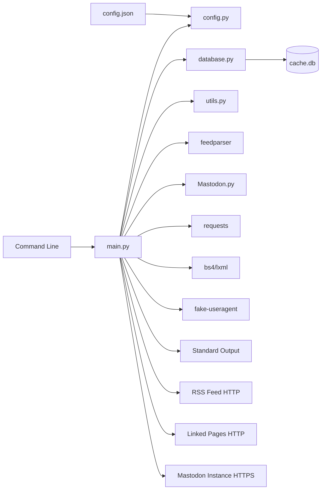
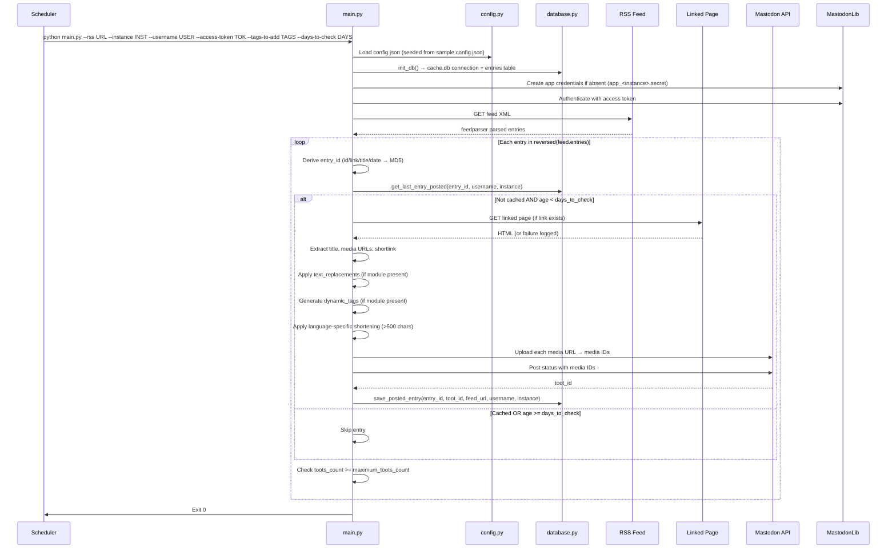
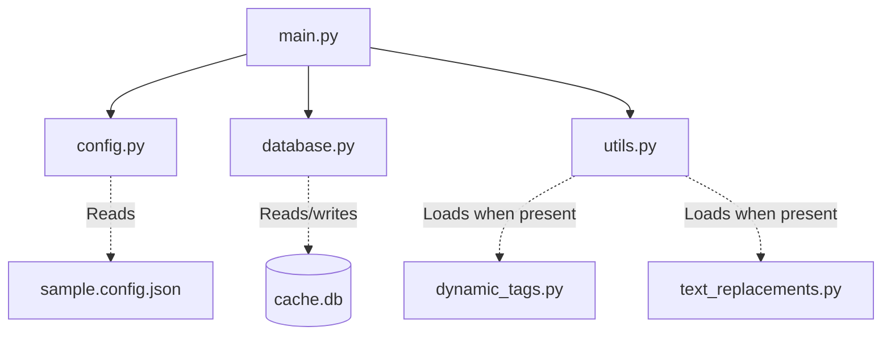

# Architecture

This document complements the root [ARCHITECTURE.md](../ARCHITECTURE.md) with implementation-level detail derived from source code inspection. It elaborates on the verified implementation rather than duplicating the root document.

## System context (implementation view)



The process boundary is the single Python interpreter started with CLI arguments. All external interactions are outbound HTTP/HTTPS.

## Architectural style (implementation detail)

The implementation is a **scheduled batch pipeline** with **modular script organisation**:

- **Single process, single thread, sequential execution** — No daemon, no background workers, no async concurrency
- **Linear stage sequence** — Configuration → Initialisation → Feed retrieval → Entry iteration (reverse order) → Deduplication → Enrichment → Transformation → Media upload → Status post → Cache persistence → Exit
- **Module boundaries** — Each `.py` file owns a distinct concern; `main.py` is the sole orchestrator and the only module importing external packages
- **Extension points** — Optional `dynamic_tags.py` and `text_replacements.py` loaded via `utils.try_import` at startup

## Runtime process (detailed sequence)



## Components (implementation responsibilities)

| Component | File | Responsibility | Key Functions/Constants | Dependencies |
|-----------|------|----------------|------------------------|--------------|
| Pipeline Orchestrator | `main.py` | Argument parsing, feed parsing, entry iteration, enrichment, media upload, toot construction, posting, cache persistence | `parse_args()`, module-level execution flow | `config.py`, `database.py`, `utils.py`, `feedparser`, `Mastodon`, `requests`, `bs4`, `fake_useragent`, `re`, `hashlib`, `datetime`, `argparse`, `base64`, `urllib` |
| Configuration Loader | `config.py` | Load `config.json`, seed from `sample.config.json`, expose typed module constants | `load_config()`, `INCLUDE_AUTHOR`, `INCLUDE_LINK`, `INCLUDE_LINK_THUMBNAIL`, `USE_PRIVACY_FRONTENDS`, `USE_SHORTLINK`, `MONETISE_LINKS`, `MAXIMUM_TOOTS_COUNT` | `json`, `os`, `shutil` |
| Persistence Layer | `database.py` | SQLite connection, schema creation, duplicate lookup, posted-entry insertion | `init_db()`, `get_last_entry_posted()`, `save_posted_entry()` | `sqlite3` |
| Utility Services | `utils.py` | Language detection, safe dynamic import of optional modules | `determine_content_language()`, `try_import()` | `importlib.util`, `os` |
| Dynamic Tags (optional) | `dynamic_tags.py` | Generate hashtags from toot body and language | `get(toot_body, toot_language) → str` | None (operator-provided) |
| Text Replacements (optional) | `text_replacements.py` | Apply language-specific text transformations | `apply(text, language) → str` | None (operator-provided) |

## Data architecture (implementation detail)

### Persistent state: SQLite `cache.db`

```sql
CREATE TABLE entries (
    feed_entry_id TEXT,   -- MD5 hash of entry identity
    toot_id TEXT,         -- Mastodon status ID
    rss_feed_url TEXT,    -- Feed URL
    mastodon_username TEXT,
    mastodon_instance TEXT
);
```

- **Created** by `database.init_db()` on first run
- **One row inserted** per successful post via `save_posted_entry()`
- **Never updated or deleted** by the application
- **Lookup** by `(feed_entry_id, mastodon_username, mastodon_instance)` via `get_last_entry_posted()`

### Transient in-memory state (per run)

| Data | Owner | Lifetime |
|------|-------|----------|
| Feed entries (`feedparser` objects) | `main.py` | Process exit |
| Linked page DOM (`BeautifulSoup`) | `main.py` | Per entry |
| Media bytes (`requests.Response.content`) | `main.py` | Per media upload |
| Composed toot body | `main.py` | Per entry |
| Configuration constants | `config.py` | Module import |

### Entry identity derivation

```python
if 'id' in feed_entry:
    feed_entry_id = feed_entry.id
elif len(feed_entry.link) > 0:
    feed_entry_id = feed_entry.link
elif len(feed_entry.title) > 0:
    feed_entry_id = feed_entry.title
elif 'published_parsed' in feed_entry:
    feed_entry_id = str(feed_entry.published_parsed)
else:
    feed_entry_id = str(feed_entry.updated_parsed)

feed_entry_id = hashlib.md5(feed_entry_id.encode()).hexdigest()
```

## Interfaces and integrations (implementation contracts)

| Interface | Direction | Protocol | Owner | Failure Semantics |
|-----------|-----------|----------|-------|-------------------|
| CLI arguments | Inbound | `argparse` | `main.py` | Missing/invalid → usage error, exit 1 |
| `config.json` | Inbound | JSON file | `config.py` | Missing → copy from `sample.config.json`; malformed → exit 1 |
| RSS feed | Outbound | HTTP GET → XML | `main.py` (via `feedparser`) | Fetch/parse failure → exit 1 |
| Linked page | Outbound | HTTP GET + rotating UA → HTML | `main.py` (via `urllib` + `bs4`) | Failure logged, entry continues without enrichment |
| Mastodon API | Outbound | HTTPS via `Mastodon.py` | `main.py` | Media failure → logged, toot proceeds without media; Status failure → entry skipped, not cached |
| SQLite cache | Outbound | Local file | `database.py` | Connection/query failure → exit 1 |

## Toot construction (detailed algorithm)

### Title extraction priority

1. **Twitter feeds** (`twitter.com` in URL or `/twitter/` in URL): `feed_entry.description` stripped of markup
2. **Standard feeds**: `feed_entry.title` if present and non-empty
3. **Linked page fallback**: `<title>` tag or `og:title` meta tag, cleaned with regex

### Filters

- **Advertisement**: Title containing `(P)` → skip entry
- **Missing title**: Regex `^[ ]*- [A-Z][a-z]*$` → `ValueError`, terminate run

### Media collection

| Source | Extraction | Transformation |
|--------|------------|----------------|
| Twitter images in `summary` | Regex `https://pbs.twimg.com/[^ \xa0\"]*` | Rewrite to Nitter: `https://nitter.unixfox.eu/pic/media%2F...` |
| Reddit media in `summary` | Regex `https://i.redd.it/[a-zA-Z0-9]*.(gif|jpg|mp4|png|webp)` | Direct use |
| Open Graph image | `meta[property='og:image']` (if `INCLUDE_LINK_THUMBNAIL`) | Direct use |
| Feed enclosures | `feed_entry.links` with `image` in `type` | Direct use |

### Link handling

```python
feed_entry_link = feed_entry.link

# Shortlink
if USE_SHORTLINK and linked_page:
    shortlink = linked_page.find('link', rel='shortlink')
    if shortlink: feed_entry_link = shortlink.href

# Privacy frontends
if USE_PRIVACY_FRONTENDS:
    feed_entry_link = feed_entry_link.replace('old.reddit.com', 'reddit.com')
    feed_entry_link = feed_entry_link.replace('reddit.com', 'libreddit.kavin.rocks')
    feed_entry_link = feed_entry_link.replace('twitter.com', 'nitter.net')
    feed_entry_link = feed_entry_link.replace('youtube.com', 'yewtu.be')

# Cleanup
feed_entry_link = feed_entry_link.replace('www.', '')
feed_entry_link = re.sub(r'\?utm.*$', '', feed_entry_link)
feed_entry_link = re.sub(r'/$', '', feed_entry_link)

# Monetisation
if MONETISE_LINKS:
    toot_body += '\n\n🔗 https://shrinkme.io/st?api=81ad7e29077269bcae6dc1773d87abbabeaa9aa8&url=' + feed_entry_link
else:
    toot_body += '\n\n🔗 ' + feed_entry_link
```

### Author and tags

```python
if INCLUDE_AUTHOR and 'authors' in feed_entry:
    toot_body += '\nby ' + feed_entry.authors[0].name

all_tags_to_add = tags_to_add  # from CLI
if dynamic_tags:
    tags_generated = dynamic_tags.get(toot_body, toot_language)
    if tags_generated:
        all_tags_to_add += ' ' + tags_generated

# Filter tags already present in body
filtered_tags = []
for tag in all_tags_to_add.split(' '):
    if '#' not in tag:
        filtered_tags.append(tag)
        continue
    if tag.lower() not in toot_body.lower() and tag.lower() not in ' '.join(filtered_tags).lower():
        filtered_tags.append(tag)

toot_body += '\n\n' + ' '.join(filtered_tags)
```

### Length management (>500 chars)

**Romanian contractions:**
- `aproximativ` → `aprox.`, `de exemplu` → `de ex.`, `deoarece` → `ptc.`, `din cauza că` → `ptc.`, `din motiv că` → `ptc.`, `este` → `e`, `în timp ce` → `cât timp`, `pe motiv că` → `ptc.`, `pe motivul că` → `ptc.`, `pentru` → `pt.`, `pentru că` → `ptc.`, `pentru motivul că` → `ptc.`, `spre exemplu` → `de ex.`, `și` → `&` (and capitalised variants)

**English contractions:**
- `and` → `&`, `are not` → `aren't`, `because` → `b/c`, `do not` → `don't`, `had not` → `hadn't`, `has not` → `hasn't`, `have not` → `haven't`, `is not` → `isn't`, `it is` → `it's`, `it will` → `it'll`, `that is` → `that's`, `there is` → `there's`, `they are` → `they're`, `was not` → `wasn't`, `were not` → `weren't`, `will not` → `won't`, `would not` → `wouldn't`, `you are` → `you're`, `you will` → `you'll`

**Post-contraction:**
- Collapse repeated `#` → single `#`
- Compress ` #` → `#`
- Truncate to 500 characters

## Cross-cutting concerns (implementation detail)

### Security and privacy

- **Trust boundary**: Operator's host
- **Network**: Outbound only to configured feed, linked pages, Mastodon instance
- **Secrets**: Access token via CLI (not persisted); app credentials in `app_<instance>.secret`
- **No telemetry**: No update checks, crash reports, or external data transfer beyond configured flows
- **Logs**: No sensitive values written to stdout

### Error handling

| Stage | Failure | Handling |
|-------|---------|----------|
| Argument parsing | Missing/invalid | Usage error, exit 1 |
| Config load | Missing file | Copy from sample; malformed JSON → exit 1 |
| DB init | Connection/schema | Exit 1 |
| App credentials | Creation | Exit 1 |
| Mastodon auth | Invalid token | Exit 1 |
| Feed retrieval | Network/parse | Exit 1 |
| Linked page | Network/parse | Log, continue without enrichment |
| Media upload | Network/API | Log, continue without that media |
| Status post | Network/API | Skip entry, do not cache (retry next run) |
| Cache write | SQLite | Exit 1 |

**Note**: Media upload uses bare `except:` clauses that swallow all exceptions.

### Observability

- **Output**: Plain-text progress logs to stdout
- **Content**: Feed entry counts, entry IDs, dates, ages, media upload attempts, composed toot body, maximum-toots exit message
- **No structured logging**, metrics, tracing, or health endpoint
- **Exit codes**: Only machine-readable success signal

## Dependency direction and rules (enforced by code)



**Rules:**
- `main.py` is the only module depending on `config.py`, `database.py`, `utils.py`, and all external packages
- `config.py`, `database.py`, `utils.py` depend only on standard library; must not import `main.py`
- Optional extensions loaded exclusively via `utils.try_import`; must not import core modules
- External packages imported directly by `main.py`; no internal abstraction layer

## External dependencies (declared vs actual)

| Package | Declared in requirements.txt | Used in code | Purpose |
|---------|------------------------------|--------------|---------|
| `feedparser` | ✅ | ✅ `main.py` | RSS/Atom parsing |
| `Mastodon.py` | ✅ | ✅ `main.py` | Mastodon API client |
| `requests` | ✅ | ✅ `main.py` | Media download |
| `bs4` | ✅ | ✅ `main.py` | HTML parsing (with lxml) |
| `fake-useragent` | ✅ | ✅ `main.py` | Rotating User-Agent |
| `lxml` | ✅ | ✅ `main.py` | bs4 parser backend |
| `argparse` | ✅ | ❌ (stdlib) | **Drift**: standard library |
| `regex` | ✅ | ❌ (uses `re`) | **Drift**: unused, code uses `re` |

## Deployment and operations (implementation reality)

| Concern | Implementation |
|---------|----------------|
| Process topology | Single short-lived CLI process per run |
| Scheduling | External (systemd timer documented in README) |
| Runtime limit | systemd `RuntimeMaxSec=60` (documented, not enforced by app) |
| Execution identity | Dedicated non-root user (operator-managed) |
| Persistent state | `cache.db`, `app_<instance>.secret`, `config.json` in working directory |
| Network posture | Outbound HTTPS only |
| Startup script | `run.sh` referenced in systemd unit — **not in repository** (operator-provided) |

## Compatibility contracts (implementation invariants)

| Contract | Owner | Invariant | Verification |
|----------|-------|-----------|--------------|
| `config.json` schema | `config.py` | 7 documented keys; `monetise_links` defaults to `true` | Manual vs `sample.config.json` |
| `cache.db` schema | `database.py` | 5 TEXT columns in fixed order | `init_db` creates table; no migration |
| CLI interface | `main.py` | 6 documented options | `argparse` help |
| Mastodon API usage | `main.py` via `Mastodon.py` | Media upload → status post with media IDs | Runtime against instance |
| Optional extension API | `utils.py` | `dynamic_tags.get(body, lang) → str`; `text_replacements.apply(text, lang) → str` | `try_import` returns `None` when absent |

## Testing and verification (current state)

**No automated test suite, test framework, or CI workflow exists.**

Verification is manual and operator-executed:
1. Run against test feed and instance
2. Inspect composed toot body in console output
3. Verify second immediate run posts nothing (deduplication)
4. Verify media attachment with image-bearing feed
5. Verify link rewriting with privacy frontends enabled

**Material verification gap**: Changes to toot construction, shortening, or deduplication logic require manual re-verification of each affected path.

## Design constraints (implementation invariants)

1. **One toot per entry** — Deduplication via MD5 hash + username + instance; posted toots never edited/deleted
2. **500-character limit** — Best-effort language-specific shortening (RO/EN only); hard truncation after
3. **Sequential execution** — No parallelism, retries, or backoff; transient failures skip entry/media
4. **Age window source** — Only from `--days-to-check`; no config default
5. **Language detection scope** — Heuristic keywords for EN/RO; others default to EN
6. **Hard-coded mappings** — Privacy frontends and monetisation service embedded in `main.py`
7. **Declared dependency drift** — `argparse` (stdlib), `regex` (unused)
8. **No automated verification** — All behaviour changes rely on manual verification

## Extension points (implementation contracts)

### Dynamic Tags

```python
# dynamic_tags.py
def get(toot_body: str, toot_language: str) -> str:
    # Return space-separated tag string or empty string
    pass
```

- Loaded once at startup via `utils.try_import`
- Must be pure function of arguments
- Generated tags filtered against tags already in toot body

### Text Replacements

```python
# text_replacements.py
def apply(text: str, language: str) -> str:
    # Return transformed string
    pass
```

- Loaded once at startup via `utils.try_import`
- Language matches `utils.determine_content_language` return values (`'en'` or `'ro'`)
- Applied before character-limit shortening

### Additional Privacy Frontends

Extend the link rewriting block in `main.py` guarded by `USE_PRIVACY_FRONTENDS`:
```python
feed_entry_link = feed_entry_link.replace('domain.com', 'frontend.domain.com')
```

### Additional Media Sources

Add extraction patterns to the summary scanning block or feed enclosure loop in `main.py`, append URLs to media collection before upload.