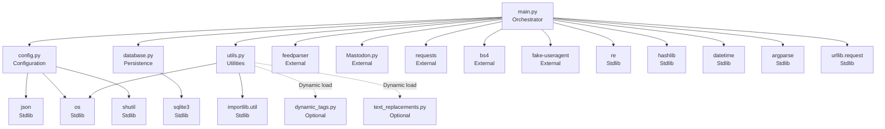

# Host and Composition

## Overview

This document describes the runtime host environment, process topology, and module composition of the mastodon-rss-bot application.

## Runtime Host

### Execution Environment

| Property | Value |
|----------|-------|
| **Runtime** | Python 3.x (version not pinned) |
| **Process Model** | Single process, single thread |
| **Execution Mode** | CLI batch job (one-shot) |
| **Working Directory** | Repository root (where `main.py` resides) |
| **Scheduler** | External (systemd timer, cron, or manual) |
| **Network** | Outbound HTTPS only |
| **Persistence** | Local filesystem (working directory) |

### Host Requirements

- Python 3.x interpreter
- Network access to RSS feed source
- Network access to linked pages (for enrichment)
- Network access to Mastodon instance (HTTPS)
- Write access to working directory (for `cache.db`, `app_*.secret`, `config.json`)

### Deployment Topology

```
┌─────────────────────────────────────────────────────────┐
│                    Host Machine                          │
│                                                          │
│  ┌────────────────────────────────────────────────────┐ │
│  │              External Scheduler                     │ │
│  │         (systemd timer / cron / manual)             │ │
│  └────────────────────┬───────────────────────────────┘ │
│                       │ invokes                          │
│                       ▼                                  │
│  ┌────────────────────────────────────────────────────┐ │
│  │           Python Process (main.py)                  │ │
│  │                                                      │ │
│  │  ┌──────────┐  ┌──────────┐  ┌──────────────────┐  │ │
│  │  │ config.py│  │database.py│  │    utils.py      │  │ │
│  │  └──────────┘  └──────────┘  └──────────────────┘  │ │
│  │                                                      │ │
│  │  ┌────────────────────────────────────────────────┐ │ │
│  │  │              main.py (orchestrator)             │ │ │
│  │  │  • CLI parsing    • Feed parsing               │ │ │
│  │  │  • Deduplication  • Enrichment                 │ │ │
│  │  │  • Media handling • Link processing            │ │ │
│  │  │  • Status posting • Cache persistence          │ │ │
│  │  └────────────────────────────────────────────────┘ │ │
│  └────────────────────────────────────────────────────┘ │
│                       │                                  │
│  ┌────────────────────┴───────────────────────────────┐ │
│  │              Local Filesystem                       │ │
│  │  • cache.db (SQLite)                               │ │
│  │  • app_<instance>.secret (Mastodon app creds)      │ │
│  │  • config.json (runtime configuration)             │ │
│  │  • dynamic_tags.py (optional extension)            │ │
│  │  • text_replacements.py (optional extension)       │ │
│  └────────────────────────────────────────────────────┘ │
└─────────────────────────────────────────────────────────┘
         │                    │                    │
         │ HTTPS              │ HTTPS              │ HTTPS
         ▼                    ▼                    ▼
   ┌───────────┐      ┌──────────────┐    ┌──────────────┐
   │ RSS Feed  │      │ Linked Pages │    │  Mastodon    │
   │  Server   │      │   (web)      │    │  Instance    │
   └───────────┘      └──────────────┘    └──────────────┘
```

## Module Composition

### Static Module Graph



### Module Responsibilities

| Module | Responsibility | Dependencies |
|--------|---------------|--------------|
| `main.py` | Pipeline orchestration, all business logic | All external + internal modules |
| `config.py` | Configuration loading, module constants | `json`, `os`, `shutil` |
| `database.py` | SQLite persistence (init, query, insert) | `sqlite3` |
| `utils.py` | Language detection, dynamic module loading | `importlib.util`, `os` |

### Composition Rules

1. **Single entry point**: `main.py` is the only executable module
2. **No circular imports**: Strict DAG, `main.py` at root
3. **Core modules are stdlib-only**: `config.py`, `database.py`, `utils.py` have zero third-party imports
4. **External packages imported only in `main.py`**: No other module imports third-party libraries
5. **Optional extensions loaded dynamically**: Via `utils.try_import()`, never static imports

## Process Lifecycle

### Startup Sequence

1. Python interpreter starts
2. `main.py` module loads
3. `config.py` imported → `load_config()` executes → constants set
4. `database.py` imported (no side effects)
5. `utils.py` imported (no side effects)
6. `main()` function called
7. Argument parsing
8. Database initialisation
9. Mastodon app creation (if needed)
10. Mastodon authentication
11. Feed retrieval
12. Entry processing loop
13. Process exit (0 on success, 1 on error)

### Shutdown Sequence

1. Entry loop completes (all entries processed or limit reached)
2. SQLite connection closed implicitly (process exit)
3. Python interpreter exits
4. No cleanup handlers registered

### State Across Runs

| State | Persistence | Location |
|-------|-------------|----------|
| Posted entry hashes | SQLite `entries` table | `cache.db` |
| Mastodon app credentials | File | `app_<instance>.secret` |
| Configuration | JSON file | `config.json` |
| Dynamic tags | Python module | `dynamic_tags.py` (optional) |
| Text replacements | Python module | `text_replacements.py` (optional) |

## Concurrency Model

- **Single process**: No multiprocessing, no threading
- **Sequential execution**: All stages run in order
- **No async**: No `asyncio`, no event loop
- **No parallelism**: One entry at a time, one HTTP request at a time
- **Implication**: Throughput limited by network latency and API rate limits

## Resource Model

### Memory

- Feed entries held in memory (all entries from feed)
- Linked page HTML held per entry (released after processing)
- Media content held per media item (released after upload)
- No streaming — full content loaded into memory

### Disk

- `cache.db` — grows with each posted entry (append-only)
- `app_<instance>.secret` — small, static after creation
- `config.json` — small, static after creation
- No temporary files for media (in-memory only)

### Network

- Outbound HTTPS only
- No inbound connections
- No listening sockets
- No webhook receivers

## Configuration Composition

### Configuration Sources (Priority Order)

1. **CLI arguments** (`--rss`, `--instance`, `--username`, `--access-token`, `--tags-to-add`, `--days-to-check`)
2. **`config.json`** (7 boolean/integer keys)
3. **`sample.config.json`** (template, copied on first run)
4. **Hard-coded defaults** (in `main.py` for privacy frontends, Nitter, ShrinkMe)

### Configuration Loading

```
config.py import → load_config() → config.json exists?
    ├─ No → copy sample.config.json → config.json
    └─ Yes → parse JSON → extract 7 keys → module constants
```

## Extension Points

### Dynamic Tags (`dynamic_tags.py`)

- **Loading**: `utils.try_import('dynamic_tags')`
- **Interface**: Module-level function or variable (see `main.py` usage)
- **Purpose**: Add tags based on entry content
- **Failure**: Missing file → skipped silently

### Text Replacements (`text_replacements.py`)

- **Loading**: `utils.try_import('text_replacements')`
- **Interface**: Module-level dictionary or list of `(pattern, replacement)` tuples
- **Purpose**: Regex-based text transformation
- **Failure**: Missing file → skipped silently

## Related Documentation

- [Architecture](../architecture.md) — System context and design
- [Repository Structure](../repository-structure.md) — File layout
- [Configuration](../configuration.md) — Configuration schema
- [Dependencies](../dependencies.md) — Module dependency graph
- [Concurrency and Scheduling](../concurrency-and-scheduling.md) — Execution model details