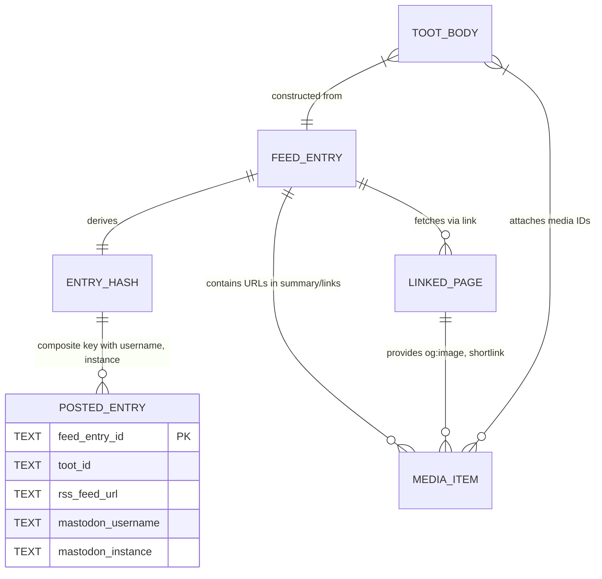

# Data Model

## Domain Entities

### Feed Entry (Transient)

**Source**: `feedparser` parsed RSS/Atom entry
**Lifetime**: Single process run, per-entry iteration
**Key Fields Used**:

| Field | Type | Purpose |
|-------|------|---------|
| `id` | string | Primary identity source for deduplication hash |
| `link` | string | Fallback identity; target for linked page fetch |
| `title` | string | Fallback identity; primary toot content source |
| `description` | string | Twitter feeds: primary toot content source |
| `summary` | string | Media URL extraction (Twitter, Reddit) |
| `published_parsed` | `time.struct_time` | Fallback identity; entry date for age filtering |
| `updated_parsed` | `time.struct_time` | Fallback identity; entry date for age filtering |
| `authors` | list[dict] | Author name when `INCLUDE_AUTHOR` enabled |
| `links` | list[dict] | Feed enclosures (images) for media upload |

### Entry Identity Hash (Persistent Key)

**Derived in**: `main.py`
**Stored in**: SQLite `cache.db` as `feed_entry_id`
**Algorithm**: MD5 hex digest of first available: `id` → `link` → `title` → `published_parsed` → `updated_parsed`

```python
if 'id' in feed_entry:
    feed_entry_id = feed_entry.id
elif len(feed_entry.link) > 0:
    feed_entry_id = feed_entry.link
elif len(feed_entry.title) > 0:
    feed_entry_id = feed_entry.title
elif 'published_parsed' in feed_entry:
    feed_entry_id = str(feed_entry.published_parsed)
else:
    feed_entry_id = str(feed_entry.updated_parsed)

feed_entry_id = hashlib.md5(feed_entry_id.encode()).hexdigest()
```

**Properties**:
- Deterministic per entry across runs
- Collision-resistant for practical purposes
- Combined with `mastodon_username` and `mastodon_instance` for composite deduplication key

### Posted Entry Record (Persistent)

**Table**: `entries` in `cache.db`
**Schema**:

```sql
CREATE TABLE entries (
    feed_entry_id TEXT,   -- MD5 hash (see above)
    toot_id TEXT,         -- Mastodon status ID returned by API
    rss_feed_url TEXT,    -- Feed URL from --rss argument
    mastodon_username TEXT,  -- Username from --username argument
    mastodon_instance TEXT   -- Instance from --instance argument
);
```

**Indexes**: None defined (full table scan on lookup)
**Constraints**: None enforced (application-level deduplication)
**Operations**:
- `INSERT` only (via `database.save_posted_entry()`)
- `SELECT` by composite key (via `database.get_last_entry_posted()`)
- No `UPDATE`, `DELETE`, or migration logic

### Linked Page Metadata (Transient)

**Source**: `BeautifulSoup` parsed HTML from linked page fetch
**Lifetime**: Per-entry processing
**Extracted Fields**:

| Field | Extraction | Used For |
|-------|------------|----------|
| `<title>` | `soup.find('title')` | Toot title fallback |
| `og:title` | `soup.find('meta', property='og:title')` | Toot title fallback |
| `og:image` | `soup.find('meta', property='og:image')` | Media URL when `INCLUDE_LINK_THUMBNAIL` |
| `shortlink` | `soup.find('link', rel='shortlink')` | Link replacement when `USE_SHORTLINK` |

### Media Item (Transient)

**Sources** (in priority order):
1. Twitter images in `summary` → rewritten to Nitter
2. Reddit media in `summary` → direct URLs
3. Open Graph image from linked page → when `INCLUDE_LINK_THUMBNAIL`
4. Feed enclosures (`links` with `image` in `type`) → direct URLs

**Processing**:
- Collected into `media_urls` list
- Deduplicated via `media_urls_posted` tracking
- Downloaded via `requests.get()` with rotating User-Agent
- Uploaded via `mastodon.media_post(content, mime_type)`
- Media IDs collected into `toot_media` for status post

### Toot Body (Transient)

**Construction Stages**:

1. **Title** (from extraction priority)
2. **Text replacements** (if `text_replacements` module present)
3. **Link** (processed: shortlink → privacy frontends → cleanup → monetisation)
4. **Author** (if `INCLUDE_AUTHOR` and `authors` present)
5. **Tags** (CLI `--tags-to-add` + `dynamic_tags.get()` → filtered against body)
6. **Length management** (if >500 chars: language contractions → truncate)

**Final Properties**:
- Maximum 500 characters (hard truncation)
- Language: `'en'` or `'ro'` (from `utils.determine_content_language()`)
- Includes media IDs for attachment

## Relationships



## State Lifecycle

### Persistent State (`cache.db`)

| Phase | Operation | Trigger |
|-------|-----------|---------|
| Initialisation | `CREATE TABLE IF NOT EXISTS` | `database.init_db()` on every run |
| Lookup | `SELECT` by composite key | Per entry, before processing |
| Insertion | `INSERT` new row | After successful status post |
| Cleanup | None | Never performed by application |

### Transient State (Per Run)

| Data | Created | Consumed | Discarded |
|------|---------|----------|-----------|
| Feed entries | `feedparser.parse()` | Entry iteration | Process exit |
| Entry hash | Per entry | Deduplication lookup | Per entry |
| Linked page DOM | Per entry (if link) | Title/media/shortlink extraction | Per entry |
| Media bytes | Per media URL | Mastodon upload | Per media |
| Toot body | Per entry | Status post | Per entry |

## Invariants

1. **One cache row per successful post** — `feed_entry_id` + `username` + `instance` uniquely identifies a posted entry
2. **Cache never updated/deleted** — Duplicate posts prevented by lookup; no edit/delete of toots
3. **Entry hash deterministic** — Same entry always produces same MD5 across runs
4. **Composite key scope** — Same entry posted to different accounts/instances creates separate cache rows
5. **No schema migration** — `CREATE TABLE IF NOT EXISTS` only; operator must manage schema changes

## Known Limitations

1. **No indexes** — Lookup scans full table; performance degrades with many entries
2. **No TTL/expiry** — Cache grows indefinitely; operator must manually prune
3. **No migration path** — Schema changes require manual intervention
4. **MD5 collision risk** — Theoretical; acceptable for this use case
5. **Single-table design** — No normalisation; feed URL, username, instance duplicated per row