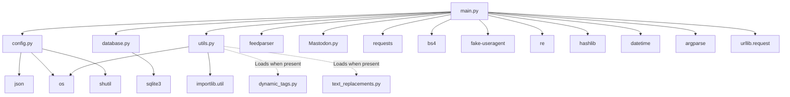

# Dependencies

## External Dependencies (Declared in requirements.txt)

| Package | Version Constraint | Actual Import | Purpose | Integration Boundary |
|---------|-------------------|---------------|---------|---------------------|
| `feedparser` | None | `import feedparser` in `main.py` | RSS/Atom feed parsing | Direct import in orchestrator |
| `Mastodon.py` | None | `from mastodon import Mastodon` in `main.py` | Mastodon API client (app creation, auth, media upload, status post) | Direct import in orchestrator |
| `requests` | None | `import requests` in `main.py` | Media file download before upload | Direct import in orchestrator |
| `bs4` | None | `from bs4 import BeautifulSoup` in `main.py` | HTML parsing (linked pages) | Direct import in orchestrator |
| `fake-useragent` | None | `from fake_useragent import UserAgent` in `main.py` | Rotating User-Agent strings for HTTP requests | Direct import in orchestrator |
| `lxml` | None | Used by `bs4` as parser backend | HTML parser for BeautifulSoup | Transitive via `bs4` |
| `argparse` | None | **Not imported** (stdlib) | **DRIFT**: Declared but standard library | N/A |
| `regex` | None | **Not imported** (uses `re`) | **DRIFT**: Declared but unused; code uses `re` | N/A |

## Standard Library Dependencies

| Module | Used In | Purpose |
|--------|---------|---------|
| `argparse` | `main.py` | CLI argument parsing |
| `base64` | `main.py` | Imported but unused |
| `datetime` | `main.py` | Entry date parsing, age calculation |
| `hashlib` | `main.py` | MD5 entry identity hashing |
| `json` | `config.py` | Configuration file parsing |
| `os` | `config.py`, `utils.py`, `main.py` | File existence, path operations |
| `re` | `main.py` | Regex extraction, cleaning, transformations |
| `shutil` | `config.py` | Copy sample config to config.json |
| `sqlite3` | `database.py` | SQLite database operations |
| `sys` | `main.py` | Exit codes, stderr |
| `timedelta` | `main.py` | Age window comparison |
| `urllib.request` | `main.py` | Linked page HTTP fetch |
| `importlib.util` | `utils.py` | Dynamic module loading |

## Internal Dependencies (Module Graph)



### Dependency Rules (Enforced by Code Structure)

1. **`main.py` is the sole importer of external packages** — No other module imports third-party libraries
2. **Core modules (`config.py`, `database.py`, `utils.py`) depend only on standard library** — Zero third-party imports
3. **Optional extensions loaded exclusively via `utils.try_import()`** — No static imports
4. **No circular dependencies** — Strict DAG with `main.py` as root
5. **No abstraction layers** — External packages used directly in `main.py`

## Integration Boundaries

### RSS Feed (Outbound HTTP GET)

- **Protocol**: HTTP/HTTPS GET
- **Format**: RSS 2.0, Atom 1.0 (via feedparser)
- **Authentication**: None (public feeds) or feed-specific (operator responsibility)
- **Timeout**: None configured (uses urllib/feedparser defaults)
- **Failure**: Process exit on fetch or parse error

### Linked Pages (Outbound HTTP GET)

- **Protocol**: HTTP/HTTPS GET
- **Headers**: Rotating User-Agent via `fake-useragent`
- **Format**: HTML (parsed with BeautifulSoup + lxml)
- **Trigger**: Per entry when `feed_entry.link` exists
- **Failure**: Logged, entry continues without enrichment

### Mastodon API (Outbound HTTPS)

- **Client**: `Mastodon.py` library
- **Endpoints Used**:
  - `Mastodon.create_app()` — App registration (once per instance)
  - `Mastodon(access_token, api_base_url)` — Authentication
  - `mastodon.media_post(content, mime_type)` — Media upload
  - `mastodon.status_post(status, media_ids)` — Status post
- **Authentication**: OAuth Bearer token (from `--access-token`)
- **App Credentials**: Stored in `app_<instance>.secret`
- **Failure**:
  - Media upload: Logged, toot proceeds without that media
  - Status post: Entry skipped, not cached (retry next run)

### SQLite Cache (Local File)

- **File**: `cache.db` in working directory
- **Schema**: Single `entries` table (5 TEXT columns)
- **Operations**: `init_db()`, `get_last_entry_posted()`, `save_posted_entry()`
- **Concurrency**: Single process, single connection
- **Failure**: Process exit on connection or query error

### Privacy Frontends (Link Rewriting)

Hard-coded domain replacements in `main.py` when `USE_PRIVACY_FRONTENDS=true`:

| Original | Rewritten To |
|----------|--------------|
| `old.reddit.com` | `reddit.com` |
| `reddit.com` | `libreddit.kavin.rocks` |
| `twitter.com` | `nitter.net` |
| `youtube.com` | `yewtu.be` |

**Not configurable** — Requires code change to modify.

### Link Monetisation (ShrinkMe.io)

Hard-coded in `main.py` when `MONETISE_LINKS=true`:

```
https://shrinkme.io/st?api=81ad7e29077269bcae6dc1773d87abbabeaa9aa8&url=<encoded_link>
```

**API key embedded in source** — Not configurable.

### Media Source Rewriting (Twitter → Nitter)

Hard-coded in `main.py`:

```
https://pbs.twimg.com/media/... → https://nitter.unixfox.eu/pic/media%2F...
```

**Not configurable** — Requires code change to modify.

## Dependency Drift Analysis

### Declared but Unused

| Package | Declared In | Actual Usage | Impact |
|---------|-------------|--------------|--------|
| `argparse` | `requirements.txt` | Standard library `argparse` used | False dependency; inflates install |
| `regex` | `requirements.txt` | Code uses `re` module | False dependency; inflates install |

### Used but Not Declared

| Package | Used In | Declared In | Impact |
|---------|---------|-------------|--------|
| `lxml` | `bs4` parser backend | `requirements.txt` (present) | OK (transitive) |

### Version Pinning

**No version constraints** in `requirements.txt` — All packages install latest compatible versions. This creates reproducibility risk.

## Security Considerations

1. **Hard-coded API key** — ShrinkMe.io key in `main.py` source
2. **Hard-coded frontend domains** — Privacy frontend mappings in `main.py`
3. **No dependency scanning** — No CI, no automated vulnerability checks
4. **No lock file** — `requirements.txt` unpinned; `pip freeze` not used
5. **Fake-useragent network call** — Fetches User-Agent list on first use (caches locally)

## Upgrade Considerations

| Dependency | Upgrade Risk | Notes |
|------------|--------------|-------|
| `feedparser` | Low | Stable API; feed format changes rare |
| `Mastodon.py` | Medium | Mastodon API changes may require client updates |
| `requests` | Low | Stable API |
| `bs4` + `lxml` | Low | Stable API |
| `fake-useragent` | Medium | Upstream User-Agent list changes; may break rotation |

## Recommendations

1. **Remove `argparse` and `regex` from `requirements.txt`**
2. **Pin versions** in `requirements.txt` or add `requirements.lock`
3. **Externalise hard-coded values** (ShrinkMe key, frontend domains, Nitter endpoint) to configuration
4. **Add dependency scanning** (e.g., `pip-audit`, GitHub Dependabot)
5. **Consider `uv` or `pip-tools`** for reproducible installs