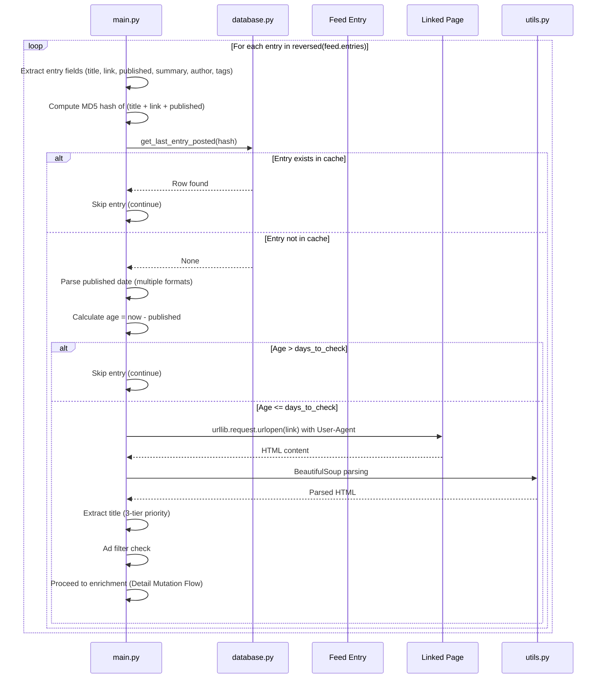

# Calendar Search Flow

## Overview

This flow covers the per-entry processing loop: identity hashing, deduplication, age filtering, linked page fetching, and title extraction — the "search" phase that determines whether an entry qualifies for posting.

## Sequence Diagram



## Detailed Steps

### 1. Entry Field Extraction

**Source**: `feed_entry` object from feedparser
**Fields Extracted**:
- `title` — `feed_entry.title` (required)
- `link` — `feed_entry.link` (required)
- `published` — `feed_entry.published` (required)
- `summary` — `feed_entry.summary` (optional, default '')
- `author` — `feed_entry.author` (optional, default '')
- `tags` — `feed_entry.tags` (optional, default [])

**Validation**: Missing required fields → skip entry (implicit via exception)

### 2. Identity Hashing

**Algorithm**: MD5
**Input**: `title + link + published` (concatenated strings)
**Code**:
```python
entry_hash = hashlib.md5(
    (feed_entry.title + feed_entry.link + feed_entry.published).encode()
).hexdigest()
```

**Purpose**: Composite key for deduplication — changes if any field changes

### 3. Deduplication Check (`database.py:get_last_entry_posted()`)

**Query**:
```sql
SELECT * FROM entries WHERE entry_hash = ?
```

**Result**:
- Row found → Entry already posted → `continue` (skip to next entry)
- No row → New entry → proceed

**Note**: No UPDATE/DELETE — cache is append-only

### 4. Age Filtering

**Date Parsing** (tried in order):
1. `%a, %d %b %Y %H:%M:%S %z` (RFC 2822 with timezone)
2. `%a, %d %b %Y %H:%M:%S %Z` (RFC 2822 with TZ name)
3. `%Y-%m-%dT%H:%M:%S%z` (ISO 8601 with timezone)
4. `%Y-%m-%dT%H:%M:%S` (ISO 8601 naive)

**Failure**: All formats fail → skip entry

**Age Calculation**:
```python
entry_date = datetime.strptime(...)
age = datetime.now() - entry_date
if age > timedelta(days=days_to_check):
    continue  # Skip old entries
```

**Note**: `datetime.now()` is naive; comparison with timezone-aware `entry_date` may raise `TypeError` in Python 3.11+

### 5. Linked Page Fetch

**Condition**: `feed_entry.link` exists
**Headers**: `User-Agent` from `fake_useragent.UserAgent().random`
**Request**:
```python
req = urllib.request.Request(feed_entry.link, headers={'User-Agent': ua.random})
response = urllib.request.urlopen(req)
html_content = response.read()
```

**Failure Modes**:
- Network error → logged, `html_content = None`, continue without enrichment
- Timeout → none configured (uses urllib default)
- Non-200 status → exception, logged, continue

### 6. Title Extraction (3-Tier Priority)

**Tier 1**: `<meta property="og:title">` content
**Tier 2**: `<title>` tag text
**Tier 3**: Fallback to `feed_entry.title`

**Code**:
```python
og_title = soup.find('meta', property='og:title')
if og_title and og_title.get('content'):
    title = og_title['content']
elif soup.title and soup.title.string:
    title = soup.title.string
else:
    title = feed_entry.title
```

### 7. Ad Filter

**Check**: `if 'ad' in title.lower():`
**Action**: `continue` (skip entry)
**Purpose**: Filter out advertisement entries

### 8. Loop Control

**Counter**: `toots_count` incremented per successful post
**Limit**: `if toots_count >= MAXIMUM_TOOTS_COUNT: break`
**Placement**: Checked at loop start (before processing next entry)

## Data Flow

```
Feed Entry → Extract Fields → MD5 Hash → Cache Lookup
                                    ↓
                              [Cached] → Skip
                                    ↓
                              [New] → Parse Date → Age Check
                                    ↓
                              [Too Old] → Skip
                                    ↓
                              [Fresh] → Fetch Linked Page → Parse HTML
                                    ↓
                              Extract Title (3-tier) → Ad Filter
                                    ↓
                              [Ad] → Skip
                                    ↓
                              [Clean] → Detail Mutation Flow
```

## Error Handling

| Stage | Exception | Handling |
|-------|-----------|----------|
| Field extraction | `AttributeError` | Implicit skip (exception propagates) |
| Hash computation | `UnicodeEncodeError` | Propagate, exit 1 |
| Cache lookup | `sqlite3.Error` | Propagate, exit 1 |
| Date parsing | `ValueError` (all formats) | Skip entry |
| Age comparison | `TypeError` (tz mismatch) | Propagate, exit 1 |
| Page fetch | `urllib.error.URLError` | Log, continue without enrichment |
| HTML parsing | `bs4` exceptions | Log, continue without enrichment |
| Title extraction | `AttributeError` | Fallback to next tier |

## Configuration Dependencies

| Config Key | Used In This Flow |
|------------|-------------------|
| `MAXIMUM_TOOTS_COUNT` | Loop termination |

## Exit Criteria

Flow completes when:
- Entry passes all filters
- Title extracted and cleaned
- Ready for media collection and content transformation (see [Detail Mutation Flow](./detail-mutation.md))

## Related Documentation

- [Startup and Rendering Flow](./startup-and-rendering.md) — Preceding flow
- [Detail Mutation Flow](./detail-mutation.md) — Following flow
- [Data Model](./data-model.md) — Entry hash and cache schema
- [Components: Application Services](./components/application-services.md) — Deduplication and age filter logic