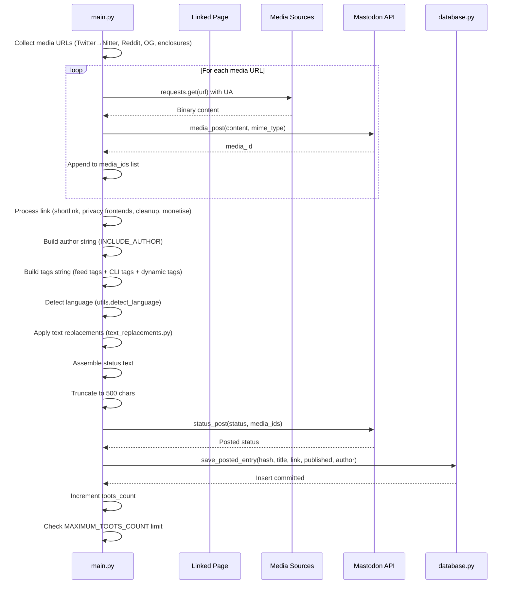

# Detail Mutation Flow

## Overview

This flow covers content enrichment, media collection, link processing, text transformation, and status posting — the "mutation" phase that transforms a qualified entry into a Mastodon toot.

## Sequence Diagram



## Detailed Steps

### 1. Media Collection

**Sources** (in priority order):

#### 1a. Twitter/X Media Rewriting

**Condition**: Entry link contains `twitter.com` or `x.com`
**Process**:
1. Extract tweet ID from URL
2. Construct Nitter URL: `https://nitter.unixfox.eu/<username>/status/<tweet_id>`
3. Fetch Nitter page
4. Extract media URLs from Nitter HTML
5. Rewrite `pbs.twimg.com` → `nitter.unixfox.eu/pic/`

**Hard-coded**: Nitter endpoint `nitter.unixfox.eu`

#### 1b. Reddit Media

**Condition**: Entry link contains `reddit.com`
**Process**:
1. Fetch Reddit JSON API: `link + '.json'`
2. Parse JSON for media URLs
3. Extract image/video URLs from post data

#### 1c. OpenGraph Images

**Condition**: Linked page fetched successfully
**Process**:
1. Parse `<meta property="og:image">` from HTML
2. Extract image URL
3. Add to media list

#### 1d. RSS Enclosures

**Condition**: `feed_entry.enclosures` exists
**Process**:
1. Iterate `feed_entry.enclosures`
2. Extract `enclosure.href` or `enclosure.url`
3. Add to media list

### 2. Media Download and Upload

**Download**:
```python
response = requests.get(media_url, headers={'User-Agent': ua.random})
media_content = response.content
```

**MIME Type Detection**:
- From URL extension (`.jpg`, `.png`, `.gif`, `.mp4`, etc.)
- Default: `image/jpeg`

**Upload**:
```python
media_response = mastodon_api.media_post(
    media_content,
    mime_type=detected_mime_type
)
media_ids.append(media_response['id'])
```

**Failure**: Logged, media skipped, toot proceeds without that media

### 3. Link Processing

**Pipeline** (applied to `feed_entry.link`):

#### 3a. Shortlink (`USE_SHORTLINK=true`)

```python
shortened = requests.get('https://is.gd/create.php?format=simple&url=' + url).text
link = shortened
```

#### 3b. Privacy Frontends (`USE_PRIVACY_FRONTENDS=true`)

Domain replacements (hard-coded):
- `old.reddit.com` → `reddit.com`
- `reddit.com` → `libreddit.kavin.rocks`
- `twitter.com` → `nitter.net`
- `youtube.com` → `yewtu.be`

#### 3c. Link Cleanup

Regex-based removal of tracking parameters:
- `utm_*` parameters
- `fbclid`
- `gclid`
- Other tracking query strings

#### 3d. Monetisation (`MONETISE_LINKS=true`)

```python
monetised = 'https://shrinkme.io/st?api=81ad7e29077269bcae6dc1773d87abbabeaa9aa8&url=' + urllib.parse.quote(link)
link = monetised
```

**Hard-coded**: ShrinkMe API key in source

### 4. Author String (`INCLUDE_AUTHOR=true`)

**Process**:
1. Extract author from `feed_entry.author`
2. Clean HTML entities
3. Format: `" by " + author`
4. Append to status text

### 5. Tags Construction

**Sources** (concatenated):
1. **Feed tags**: `feed_entry.tags` → extract `term` field
2. **CLI tags**: `--tags-to-add` argument (comma-separated)
3. **Dynamic tags**: `dynamic_tags.py` (if present, loaded via `try_import`)

**Processing**:
- Strip `#` prefix if present
- Remove spaces and special characters
- Prefix with `#`
- Join with spaces

### 6. Language Detection (`utils.detect_language()`)

**Algorithm**:
1. Check for Romanian diacritics (ă, â, î, ș, ț)
2. Count Romanian keywords in text
3. Count English keywords in text
4. Return `'ro'` or `'en'` based on counts

**Usage**: Logged, may influence text replacements

### 7. Text Replacements (`text_replacements.py`)

**Condition**: File exists in working directory
**Loading**: `utils.try_import('text_replacements')`
**Format**: Module-level dictionary or list of `(pattern, replacement)` tuples
**Application**: Regex substitution on status text

### 8. Status Assembly

**Components** (in order):
1. Title (extracted, cleaned)
2. Author string (if `INCLUDE_AUTHOR`)
3. Link (processed)
4. Tags string
5. Summary/excerpt (if configured)

**Assembly**: Concatenated with newlines/spaces

### 9. Character Limit Enforcement

**Limit**: 500 characters (Mastodon limit)
**Process**:
```python
if len(status) > 500:
    status = status[:500]
```

**Note**: Hard truncation — may cut mid-word, mid-URL, mid-tag

### 10. Status Posting

**Code**:
```python
mastodon_api.status_post(
    status=status_text,
    media_ids=media_ids
)
```

**Failure**: Exception → log error, skip entry (do not cache), continue to next entry

### 11. Cache Persistence (`database.py:save_posted_entry()`)

**Code**:
```python
save_posted_entry(db, entry_hash, title, link, published, author)
```

**SQL**:
```sql
INSERT INTO entries (entry_hash, entry_title, entry_link, entry_published, entry_author)
VALUES (?, ?, ?, ?, ?)
```

**Note**: INSERT only — no UPDATE, no conflict resolution

### 12. Loop Control

**Counter**: `toots_count += 1`
**Limit Check**: `if toots_count >= MAXIMUM_TOOTS_COUNT: break`
**Placement**: At loop start (before next entry processing)

## Data Flow

```
Qualified Entry → Media Collection → Media Upload → media_ids[]
                ↓
            Link Processing → Processed Link
                ↓
            Author String (optional)
                ↓
            Tags Construction → Tags String
                ↓
            Language Detection → Language Code
                ↓
            Text Replacements → Modified Text
                ↓
            Status Assembly → Raw Status
                ↓
            Truncate to 500 → Final Status
                ↓
            status_post(status, media_ids) → Posted
                ↓
            save_posted_entry() → Cache Updated
                ↓
            toots_count++ → Check Limit
```

## Error Handling

| Stage | Exception | Handling |
|-------|-----------|----------|
| Media download | `requests.RequestException` | Log, skip media |
| Media upload | `Mastodon.MastodonError` | Log, skip media |
| Link shortening | `requests.RequestException` | Log, use original link |
| Status post | `Mastodon.MastodonError` | Log, skip entry (no cache) |
| Cache insert | `sqlite3.Error` | Propagate, exit 1 |
| Text replacement | `Exception` | Log, continue with original text |

## Configuration Dependencies

| Config Key | Used In This Flow |
|------------|-------------------|
| `INCLUDE_AUTHOR` | Author string construction |
| `INCLUDE_LINK` | Link inclusion in status |
| `INCLUDE_LINK_THUMBNAIL` | Thumbnail media collection |
| `USE_PRIVACY_FRONTENDS` | Link rewriting |
| `USE_SHORTLINK` | Link shortening |
| `MONETISE_LINKS` | Link monetisation |
| `MAXIMUM_TOOTS_COUNT` | Loop termination |

## Exit Criteria

Flow completes when:
- Entry posted and cached successfully
- OR entry skipped due to posting failure
- OR `MAXIMUM_TOOTS_COUNT` reached (loop breaks)

## Related Documentation

- [Calendar Search Flow](./calendar-search.md) — Preceding flow
- [Startup and Rendering Flow](./startup-and-rendering.md) — Initialisation
- [Configuration](./configuration.md) — Config keys used
- [Components: Application Services](./components/application-services.md) — Media and link processing logic
- [Components: Integration Models](./components/integration-models.md) — External service interactions