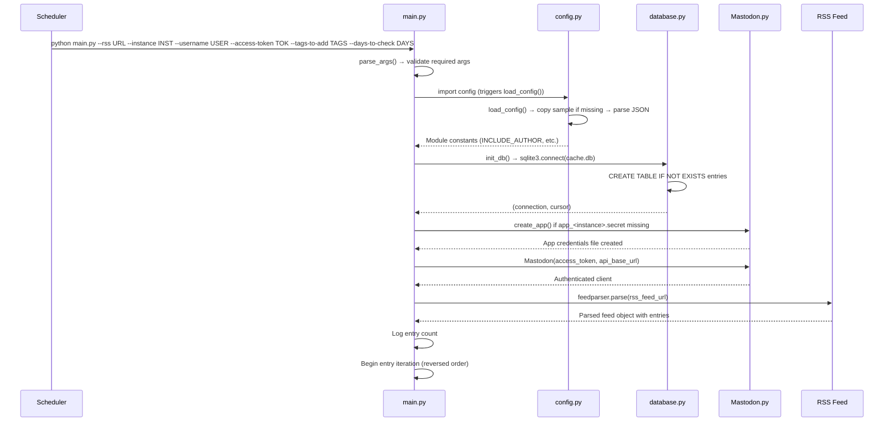

# Startup and Rendering Flow

## Overview

This flow covers process startup, configuration loading, client initialisation, and feed retrieval — the first phase of the batch pipeline.

## Sequence Diagram



## Detailed Steps

### 1. Argument Parsing (`main.py:parse_args()`)

**Input**: `sys.argv`
**Required Arguments**:
- `--rss` — RSS feed URL
- `--instance` — Mastodon instance domain
- `--username` — Mastodon username
- `--access-token` — OAuth access token

**Optional Arguments**:
- `--tags-to-add` — Comma-separated hashtags
- `--days-to-check` — Age window in days

**Validation**: `argparse` enforces required args; missing → usage error, exit 1

### 2. Configuration Loading (`config.py:load_config()`)

**Trigger**: Module import of `config` in `main.py`
**Process**:
1. Check `config.json` existence
2. If missing → `shutil.copy(SAMPLE_FILE, CONFIG_FILE)`
3. Parse JSON with `json.load()`
4. Extract 7 keys as module constants
5. `MONETISE_LINKS` uses `.get("monetise_links", True)` default

**Failure Modes**:
- Missing `sample.config.json` → `FileNotFoundError`, exit
- Malformed JSON → `json.JSONDecodeError`, exit
- Missing keys (except `monetise_links`) → `KeyError`, exit

### 3. Database Initialisation (`database.py:init_db()`)

**Process**:
1. `sqlite3.connect("cache.db")` → connection
2. `connection.cursor()` → cursor
3. Execute `CREATE TABLE IF NOT EXISTS entries (...)`
4. `connection.commit()`
5. Return `(connection, cursor)`

**Failure Modes**:
- Permission denied on `cache.db` → `sqlite3.OperationalError`, exit
- Disk full → `sqlite3.OperationalError`, exit

### 4. Mastodon App Credentials (`Mastodon.create_app()`)

**Condition**: `not os.path.isfile("app_" + mastodon_instance + '.secret')`
**Process**:
1. `Mastodon.create_app(rss_feed_domain, api_base_url='https://' + mastodon_instance, to_file="app_" + mastodon_instance + '.secret')`
2. `rss_feed_domain` = `re.sub('^[a-z]*://', '', rss_feed_url)`
3. Log success/failure

**Failure**: Returns falsy → log failure, exit 1

### 5. Mastodon API Authentication

**Process**:
```python
mastodon_api = Mastodon(
    access_token=mastodon_access_token,
    api_base_url='https://' + mastodon_instance
)
```

**Failure**: Exception → log error with username/instance, exit 1

### 6. Feed Retrieval and Parsing

**Process**:
```python
feed = feedparser.parse(rss_feed_url)
```

**Logging**: `print('Retrieved ' + str(len(feed.entries)) + ' feed entries!')`

**Failure**: feedparser exceptions propagate → exit 1 (no explicit try/except)

### 7. Entry Iteration Setup

**Order**: `reversed(feed.entries)` — oldest first
**Counter**: `toots_count = 0`
**Limit Check**: `MAXIMUM_TOOTS_COUNT` from config

## Data Flow

```
CLI Args → parse_args() → Local Variables
                ↓
config.py import → load_config() → Module Constants
                ↓
database.init_db() → (sql, db) → SQLite Connection
                ↓
Mastodon.create_app() → app_<instance>.secret
                ↓
Mastodon(access_token) → Authenticated Client
                ↓
feedparser.parse() → Feed Object → entries list
                ↓
reversed(entries) → Iteration Loop
```

## Error Handling

| Stage | Exception | Handling |
|-------|-----------|----------|
| Argument parsing | `SystemExit` (argparse) | Usage printed, exit 1 |
| Config load | `FileNotFoundError`, `JSONDecodeError`, `KeyError` | Propagate, exit 1 |
| DB init | `sqlite3.Error` | Propagate, exit 1 |
| App creation | Any | Check return value, exit 1 |
| Mastodon auth | Any | Catch, log, exit 1 |
| Feed parse | Any | Propagate, exit 1 |

## Configuration Dependencies

| Config Key | Used In This Flow |
|------------|-------------------|
| `MAXIMUM_TOOTS_COUNT` | Loop termination condition |

## Exit Criteria

Flow completes when:
- Feed parsed successfully
- Entry iteration begins
- First entry processing starts (see [Calendar Search Flow](./calendar-search.md))

## Related Documentation

- [Architecture](./architecture.md) — System context and runtime process
- [Configuration](./configuration.md) — Config schema and loading
- [Data Model](./data-model.md) — Feed entry and cache structures
- [Components: Host and Composition](./components/host-and-composition.md) — Process topology